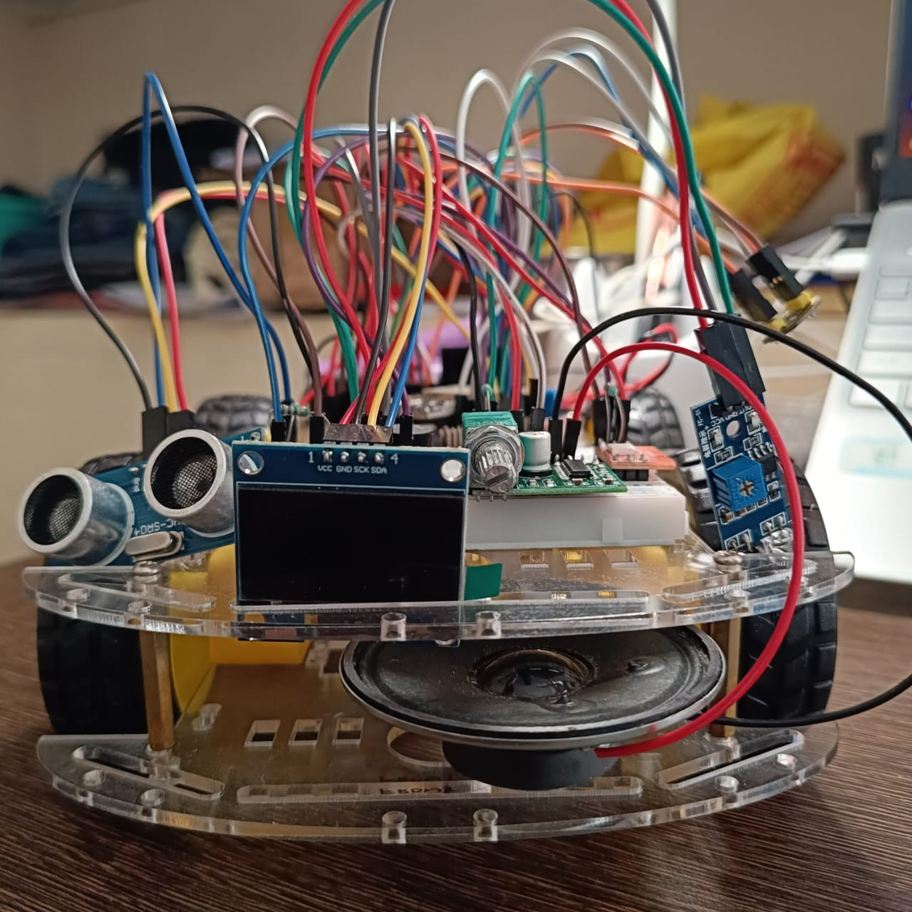
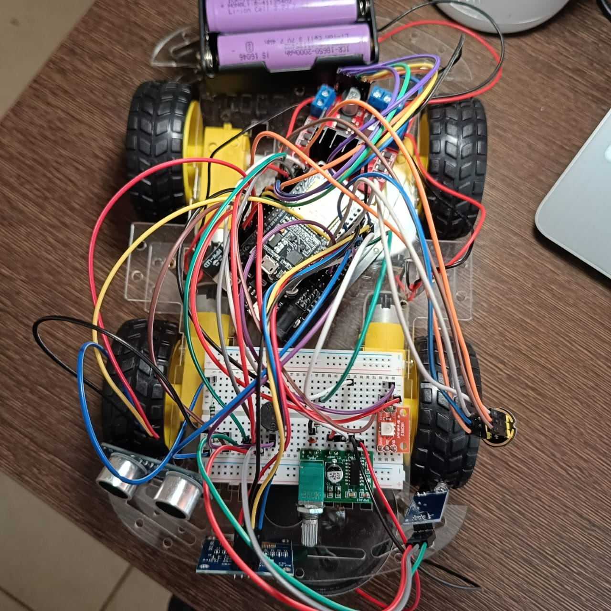
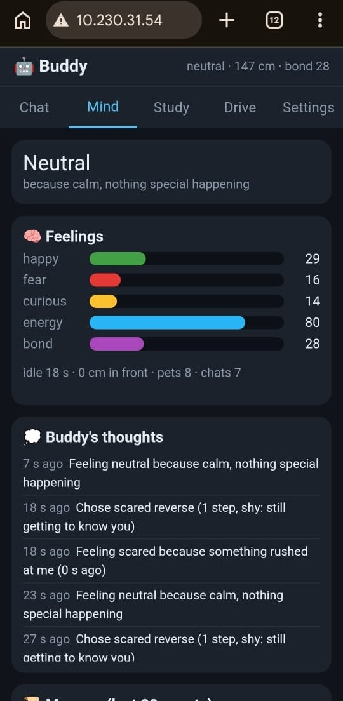
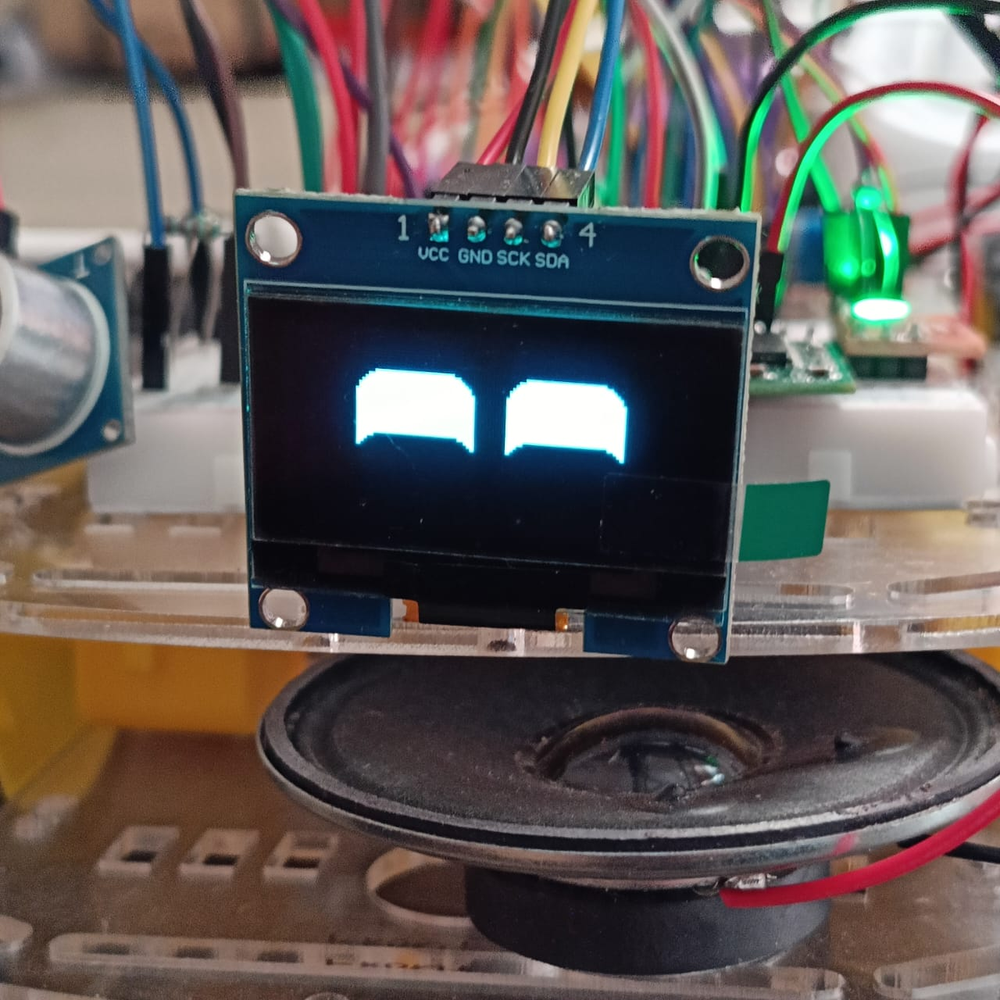
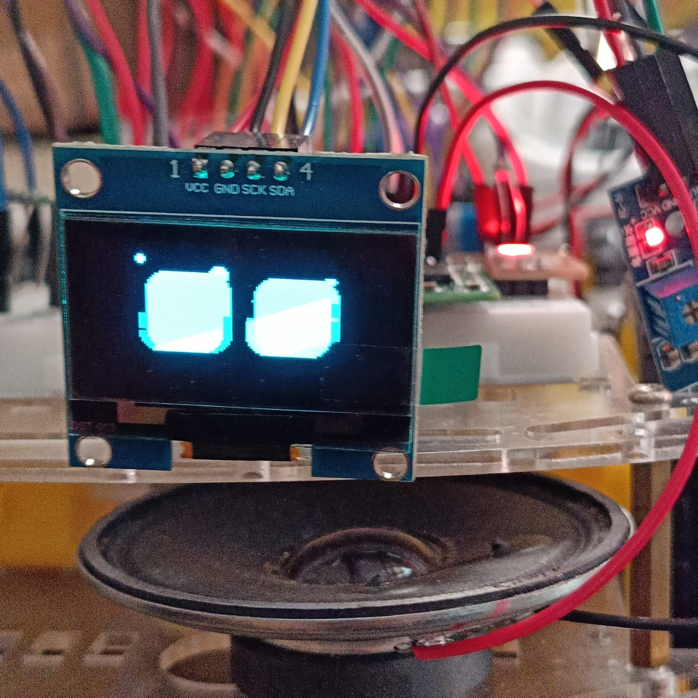
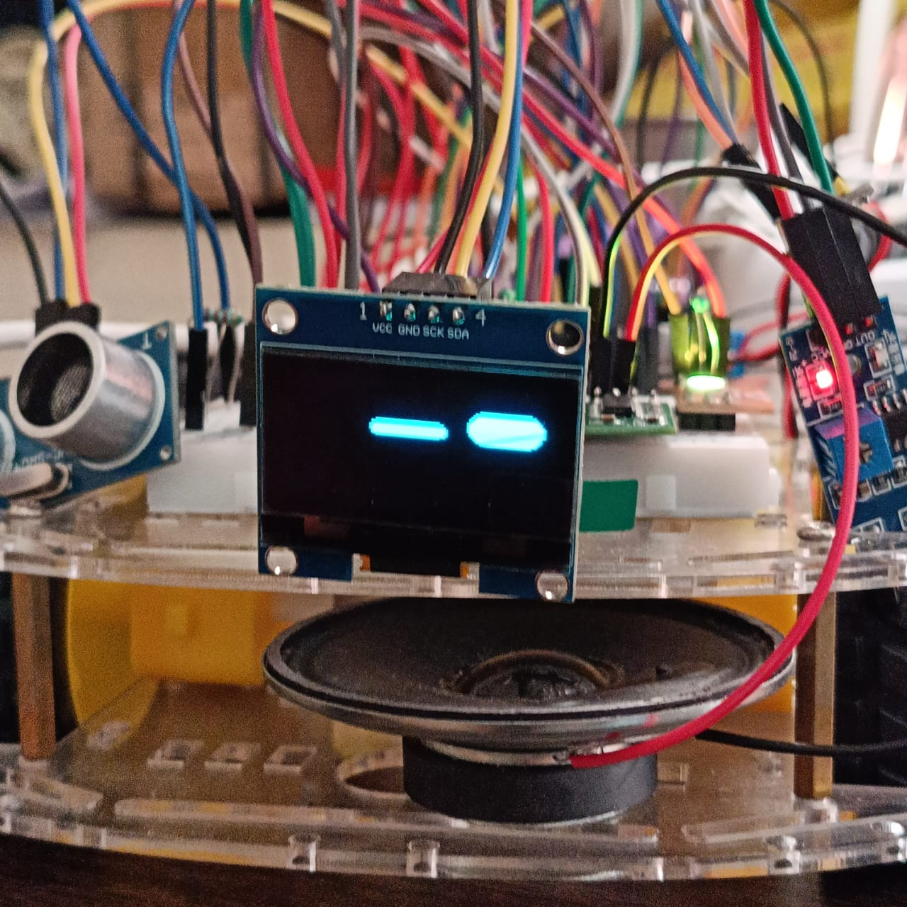
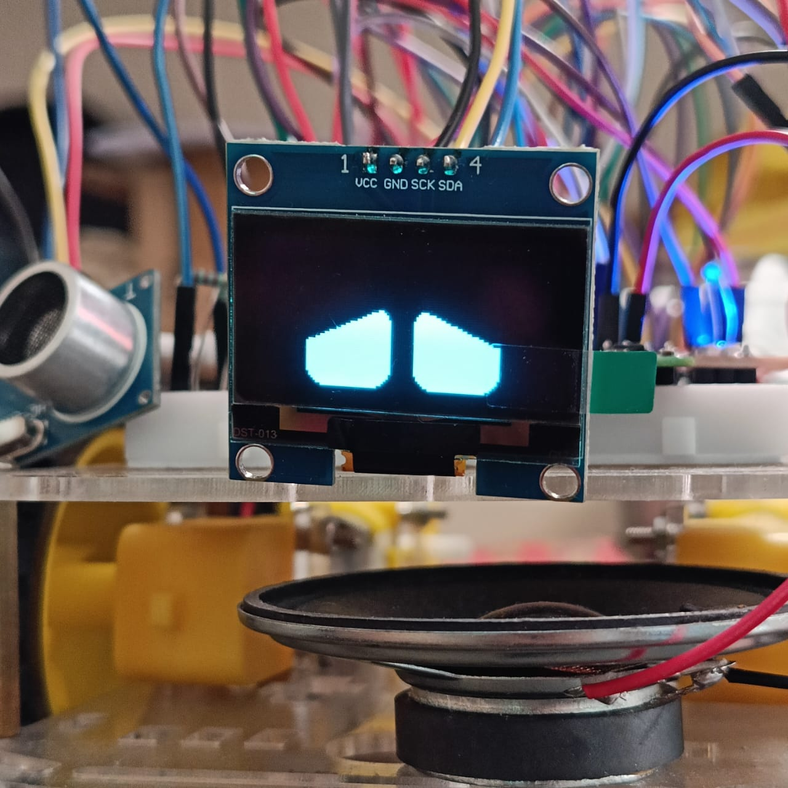
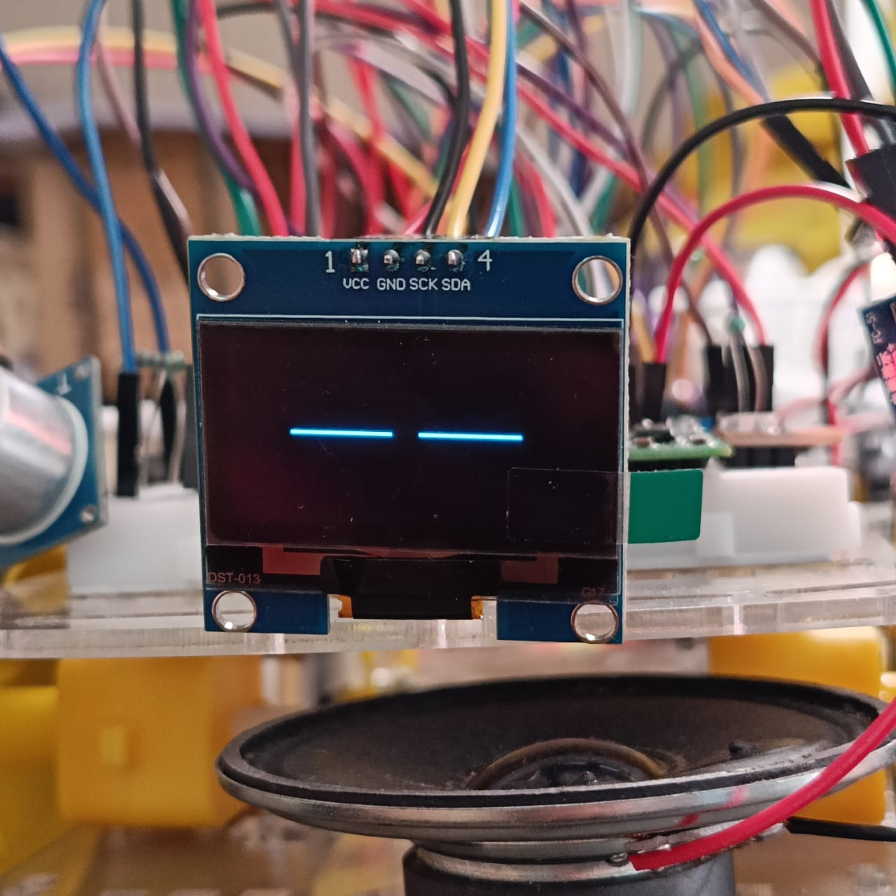
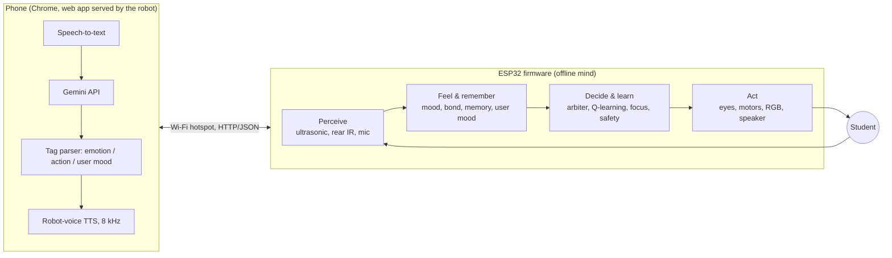

# Buddy: a cognitive study-companion robot on an ESP32

Buddy is a small four-wheel robot car with feelings. It shows emotions with animated eyes on an OLED, reacts to people moving in front of it, remembers how it has been treated, **learns which of its behaviours you like**, notices when you leave your desk during a study session, and estimates how *you* are feeling. It talks and helps you study through a web app it serves to your phone.

The whole "mind" (perception, mood, memory, learning, attention) runs **on the ESP32 itself, offline**. The phone only adds speech input and the link to a cloud language model (Google Gemini).

> Course project, Cognitive Robotics, School of Computer Science and Engineering, VIT Chennai.
> Authors: Samarpan Bera, Sohan Bose. Guide: Dr. S. Pavithra.


<p align="center">
  
  
  
</p>

| Happy | Scared | Curious | Sad | Sleepy |
|---|---|---|---|---|
|  |  |  |  |  |

More photos (focus mode on the OLED, learning card, user-mood card, chat) are in [`photos/`](photos/).

---

## Features

### Cognitive core (runs on the ESP32)
| Feature | What it does | Code |
|---|---|---|
| **Mood engine** | Four continuous feelings (happy, fear, curious, energy, 0-100) that react to events and decay back to a baseline every second. The happiness baseline rises with the bond. | `src/main/mood.cpp` |
| **Memory and bond** | Ring buffer of the last 20 events; bond, pet/chat counts, learnt values and last focus score are saved in flash (NVS) and survive a reboot. | `src/main/mood.cpp` |
| **Behaviour arbiter** | Emotion chosen by priority (scared > happy > curious > sad > sleepy > neutral); each emotion has eyes, light, sound and a short, safety-limited movement. Low bond makes Buddy shy. | `src/main/main.cpp`, `drive.cpp` |
| **Learning from feedback** | One-step Q-learning (contextual bandit): when lonely, Buddy tries one of 5 social moves and learns from your reaction (pet, praise, thumbs up/down, being ignored). 4 states x 5 actions, epsilon-greedy 0.3 -> 0.1. | `src/main/learn.cpp` |
| **Focus companion** | During a Pomodoro session the ultrasonic sensor checks you are at the desk. Away too long -> sad eyes and "Hey, come back!". End-of-session focus score; a low score makes it nudge sooner next time. | `src/main/focus.cpp` |
| **User-mood estimate** | Camera-free guess of how you feel (calm / happy / stressed / tired / confused) from what you say, quiz results, study time and how you treat Buddy; changes the tone and quiz difficulty. | `src/main/usermood.cpp` |
| **Thoughts log** | One plain-language line per decision ("Feeling scared because something rushed at me"), shown on Serial and in the phone's Mind tab. | `src/main/thoughts.cpp` |

### Expression and interaction
- Animated eyes (FluxGarage RoboEyes) on a 1.3" SH1106 OLED: neutral, happy, sad, scared, curious, sleepy, excited, thinking, talking.
- WS2812 RGB mood light, speaker sound effects per emotion (buzzer as fallback).
- **Robot voice:** replies are synthesised on the phone, sent as 8 kHz audio and played on Buddy's own speaker (PWM -> RC filter -> PAM8403).
- Safe motion: PWM caps, kick-start, 600 ms drive watchdog, no forward motion below 15 cm, no reverse when the rear IR sees an obstacle.

### Phone web app (served by the robot, no install)
- **Chat** by text or voice, answered by Gemini; Buddy's mood colours the answer, and the reply's emotion tag drives the robot's face.
- **Mind** tab: live mood bars, "because ..." reason, event memory, learning bars with thumbs buttons, user-mood card, thoughts log. Works without internet.
- **Study** tab: Explain (short explanation + check question), multiple-choice Quiz with streaks, Pomodoro focus timer.
- **Drive** tab (D-pad) and **Settings** (API key stored only in the phone's browser).

### On-board microphone (sound sensing, experimental)
The robot has an INMP441 I2S microphone and the code for it is included:
- `src/main/hears.cpp`: "Buddy hears", the mic used as a sound sensor (clap -> startled, voice nearby -> curious/listening). Switched by `HEAR_ENABLED` in `src/main/config.h`.
- `src/test_mic/main.cpp`: a 4-way diagnostic (sample rates, APLL clock, gain) that streams raw recordings to a laptop.
- `recordings/`: the WAV files from that diagnostic.

On our unit every recording contained only noise (83-93 % of the energy below 300 Hz in all four settings), so the module is most likely faulty or its sound port is blocked. `HEAR_ENABLED` is therefore `false` and speech input uses the phone's microphone. Replacing the mic module should enable the feature without code changes.

---

## Architecture



**Cognitive loop:** Perceive -> Feel and remember -> Decide and learn -> Act -> (the student reacts) -> Adapt.

---

## Hardware

| Part | Role |
|---|---|
| ESP32 DevKit V1 (30-pin, ESP32-D0WD-V3, 4 MB flash) + G/V/S expansion board | Controller, Wi-Fi |
| 1.3" OLED, SH1106, I2C | Eyes |
| 4WD chassis, 4 BO motors, L298N driver | Skid-steer motion |
| HC-SR04 ultrasonic (front, 1k/2k divider on ECHO) | Distance, approach, presence |
| IR obstacle sensor (rear) | Reverse safety |
| WS2812 RGB LED, active buzzer | Mood light, fallback beeps |
| PAM8403 amplifier + 8 ohm speaker (GPIO5 PWM -> 2k / 10 nF RC filter) | Voice and sound effects |
| INMP441 I2S microphone | Sound sensing (see above) |
| 3 x 18650 (motors), USB power bank (logic) | Power, common ground |

### Pin map (`include/pins.h`)
| Module | Signal | GPIO |
|---|---|---|
| OLED | SDA / SCL | 21 / 22 |
| L298N left | ENA (PWM), IN1, IN2 | 25, 26, 27 |
| L298N right | ENB (PWM), IN3, IN4 | 23, 32, 33 |
| HC-SR04 | TRIG / ECHO (via divider) | 17 / 16 |
| IR sensor (rear) | OUT | 34 |
| WS2812 | DI (via 330 ohm) | 2 |
| Buzzer | + | 19 |
| Speaker path | PWM -> RC filter -> PAM8403 | 5 |
| INMP441 | SCK / WS / SD | 14 / 18 / 35 |
| TTP223 touch (optional, not fitted) | I/O | 4 |

Power: motors from the 18650 pack through the L298N; ESP32 and sensors from USB only. L298N GND must be connected to ESP32 GND.

---

## Repository layout

```
include/            pins.h (pin map), secrets.example.h (Wi-Fi template)
src/main/           main firmware
  main.cpp          setup + non-blocking main loop (millis() timers only)
  config.h          feature switches (motors, mic, learning, demo timings, sound output)
  mood.*            mood engine, bond, event memory (NVS)
  learn.*           Q-learning of social moves
  focus.*           Pomodoro + desk-presence monitor
  usermood.*        user-mood estimate
  thoughts.*        plain-language decision log
  sensors.*         ultrasonic (median filter), rear IR, event detection
  drive.*           motors + safety layer + behaviour moves
  eyes.*            RoboEyes on SH1106
  sound.*, speaker.* sound effects, RGB, 8 kHz voice playback
  hears.*           mic as sound sensor (HEAR_ENABLED)
  net.*, web.*      Wi-Fi + HTTP API
  web_page.h        the phone web app (HTML/CSS/JS in one string)
src/test_*/         stand-alone hardware tests (one PlatformIO env each)
recordings/         microphone diagnostic recordings (WAV)
photos/             photos of the robot, its eyes and the phone app
DEMO.md             one-page demo script
```

---

## Getting started

1. Install **VS Code + PlatformIO**. The platform is pinned (`espressif32@7.1.3`, Arduino core 2.0.17) and libraries are pinned in `platformio.ini`.
2. Copy `include/secrets.example.h` to `include/secrets.h` and enter your phone hotspot name and password (2.4 GHz). `secrets.h` is git-ignored.
3. Connect the ESP32 by its own micro-USB and upload the main firmware:
   ```
   pio run -e main -t upload
   pio device monitor
   ```
   If the wrong serial port is picked, set `upload_port` / `monitor_port` in `platformio.ini`.
4. The robot's IP address appears on the OLED at boot. On the phone (same hotspot) open `http://<robot-ip>/` in Chrome.
5. In **Settings**, paste a free Gemini API key (from Google AI Studio). It is stored only in the phone's browser, never on the robot or in this repository.
6. For the mic button on an `http://` page, enable `chrome://flags/#unsafely-treat-insecure-origin-as-secure` for `http://<robot-ip>`.

### Hardware test environments
| Env | Purpose |
|---|---|
| `test_toolchain` | Blink + chip info (PSRAM, flash, core version) |
| `test_oled` | I2C scan, OLED pattern, eye animations |
| `test_motors` | Interactive motor test and PWM ramp (wheels lifted) |
| `test_sensors` | Ultrasonic, rear IR, buzzer, RGB LED at 5 Hz |
| `test_audio` | Speaker tone sweep and sample playback |
| `test_mic` | INMP441 diagnostic recordings |
| `main` | Full robot firmware |

### Feature switches (`src/main/config.h`)
`MOTORS_ENABLED`, `TOUCH_ENABLED`, `HEAR_ENABLED`, `SOUND_OUTPUT` (speaker / buzzer), `LEARN_ENABLED`, `DEMO_MODE` (sad after 20 s and sleepy after 60 s instead of 60 s / 5 min).

---

## HTTP API (ESP32)
| Endpoint | Purpose |
|---|---|
| `GET /` | Phone web app |
| `GET /state` | Emotion, mood values, bond, distance, IR, uptime (JSON) |
| `GET /mind` | Mind view data: reason, memory, thoughts, learning values |
| `GET /usermood?m=...&why=...` | User mood guessed by the AI, with its evidence |
| `GET /learn?mode=on\|off`, `?thumb=1\|-1`, `?reset=1` | Learning mode, thumbs feedback, reset |
| `GET /emotion?e=...&ms=...` | Show an emotion |
| `GET /drive?d=f\|b\|l\|r\|s&speed=0-100` | Drive (600 ms watchdog) |
| `GET /event?type=...` | Praise, chat start, quiz correct/wrong, ... |
| `GET /beep?p=...`, `GET /sound?fx=on\|off` | Play a sound / switch robot sound effects |
| `GET /focus?mode=work\|break\|stop&min=N` | Pomodoro focus session |
| `POST /play`, `GET /stopvoice` | Stream 8 kHz audio to the speaker / stop it |

---

## Limitations and future work
- One narrow ultrasonic beam cannot tell a person from an object; pets and presence are inferred from distance patterns.
- Speech input, language and speech synthesis depend on the phone and on free-tier cloud models, which can be slow.
- The on-board microphone needs replacing before on-board listening and sound reactions can be enabled.
- Floor calibration of the motors and a user study are future work; a touch sensor and a second ultrasonic sensor (person following) are planned extensions (GPIO4, 13, 15 reserved).

## License
MIT. See [LICENSE](LICENSE).
